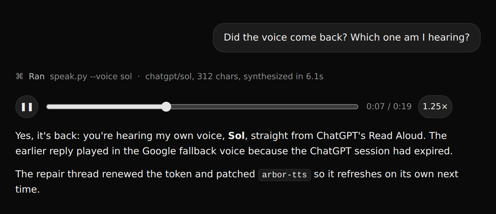

# T3 Code voice skill

An agent skill that makes coding agents in [T3 Code](https://t3.codes) answer
out loud. Every reply comes with a small player that starts playing on its
own, voiced by one of ChatGPT's Read Aloud voices.



## How it works

The agent writes its reply, pipes the same text into `skill/speak.py`, and
passes the script's output to T3's `html_render` tool. The script:

1. Removes everything that sounds bad when read aloud: Markdown markup, code
   blocks, URLs and file paths.
2. Synthesizes speech. Each agent has its own voice: Claude Opus speaks with
   `sol`, Claude Fable with `breeze`, Codex with `arbor`.
3. Saves the MP3 behind a PNG signature with a `.png` name. `html_render`
   inlines only local files that look like images, so this is how the audio
   gets into the page. The player strips the signature before playback.
4. Prints a player with play/pause, seek and a remembered playback speed.
   Media keys work too.

## Voices and fallbacks

- **ChatGPT Read Aloud voices** come from
  [arbor-chatgpt-voice](https://github.com/iliyasone/arbor-chatgpt-voice), a
  local service that exposes them as an OpenAI-compatible `/v1/audio/speech`
  endpoint at `127.0.0.1:8811`. You can point the script at another address
  with `ARBOR_TTS_URL`.
- **Google Translate's free voice** takes over when the ChatGPT voice fails.
- **OpenAI `gpt-audio-1.5`** is paid, so the script uses it only when both
  voices above fail. The key comes from `OPENAI_API_KEY` or
  `~/.config/openai-voice/env`.

## Self-repair

When the ChatGPT voice fails, `speak.py` posts the error to the webhook URL
in `~/.config/t3-voice/repair-webhook`, at most once every 3 hours. That URL
belongs to a T3 webhook task (`schedule_task` with `{"type":"webhook"}`), and
the task opens a new thread with a brief on how to repair the voice service.
That thread usually renews an expired ChatGPT session.

## Install

```bash
git clone https://github.com/iliyasone/t3-code-voice-skill
ln -s "$PWD/t3-code-voice-skill/skill" ~/.agents/skills/t3-voice
ln -s ../../.agents/skills/t3-voice ~/.claude/skills/t3-voice   # Claude Code
ln -s ../../.agents/skills/t3-voice ~/.codex/skills/t3-voice    # Codex
```

[SKILL.md](skill/SKILL.md) is written for one person's setup: it tells
Claude to speak of herself in the feminine in Russian. Adapt it to yours.
